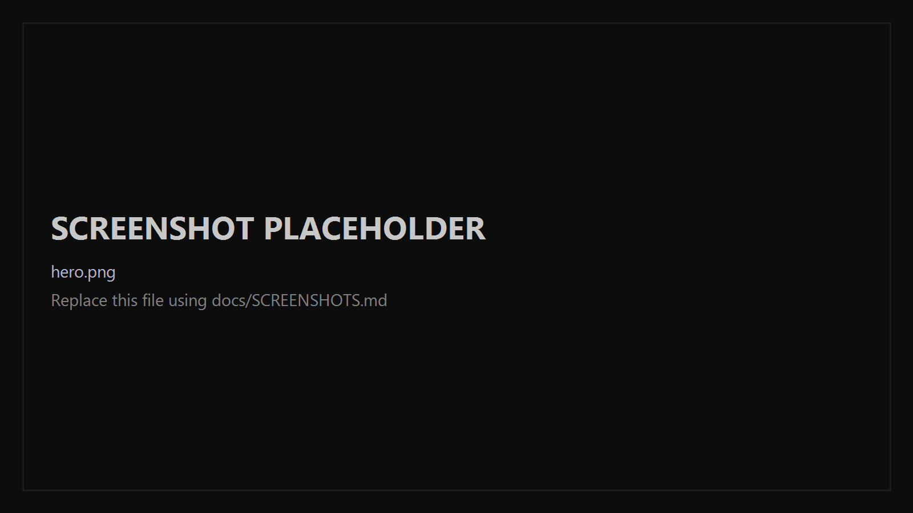
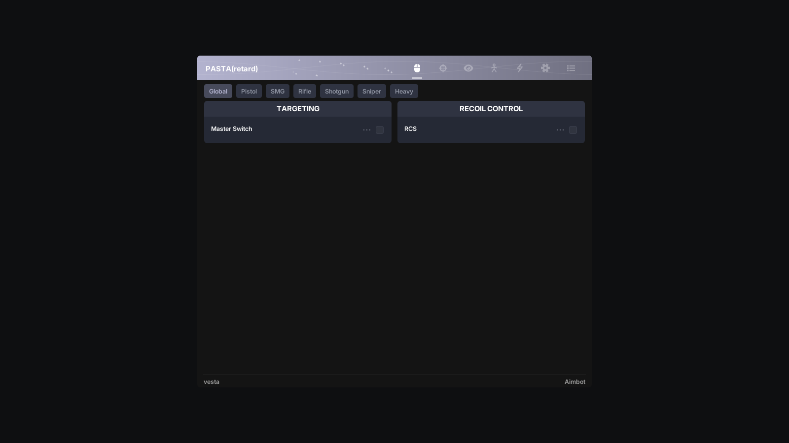
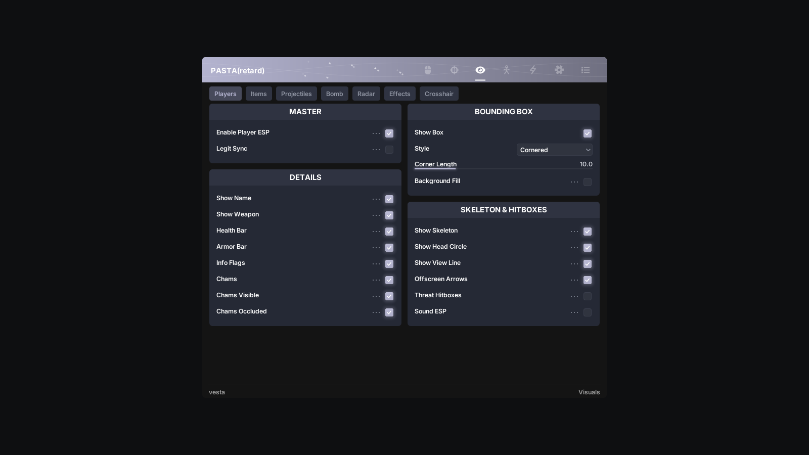
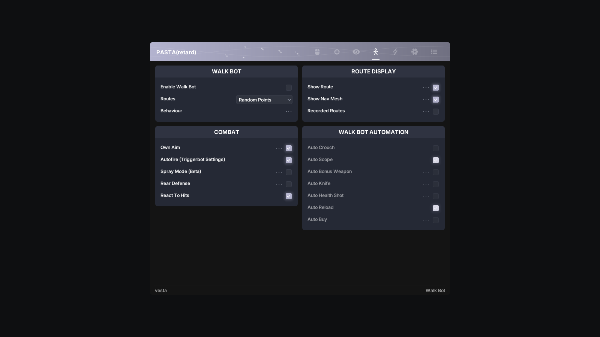
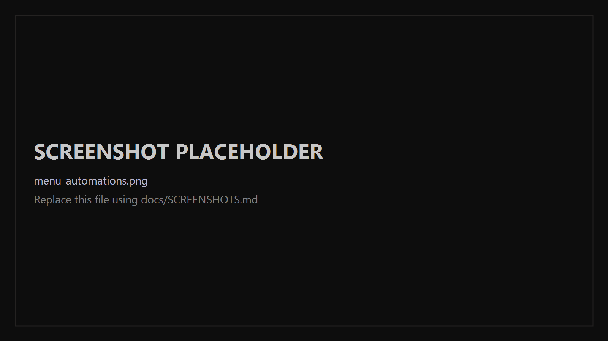
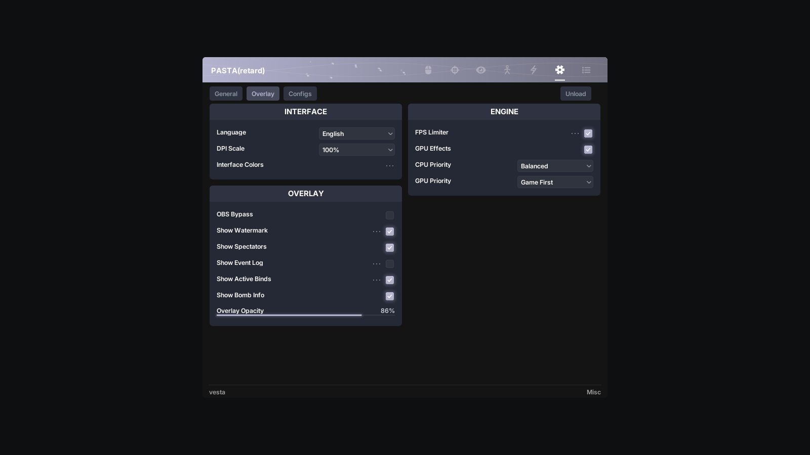
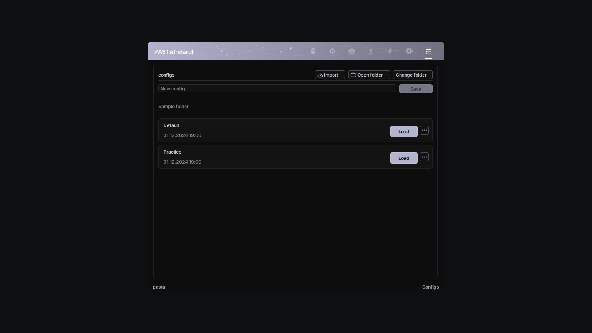
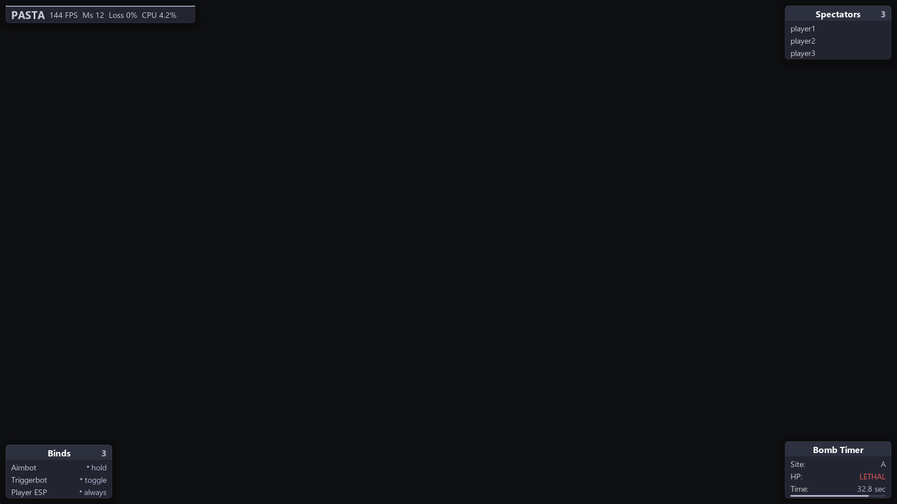

# PASTA

PASTA is a Windows x64 external assist for Counter-Strike 2. It reads game memory read-only and draws a separate DirectX 11 overlay: no injection, no driver.




## Features

| Area | What it covers |
| --- | --- |
| Aimbot | Target selection, FOV modes, humanizer, prediction, multi-point aiming, RCS, penetration, and per-weapon-group overrides. |
| Triggerbot | Hold, always-on, and toggle activation; seed modes; hitboxes; reaction time and hitchance; Auto Stop; penetration; predictive and lethal-only modes. |
| Visuals | Player ESP, box and bar styles, info flags, chams, skeleton and hitboxes, sound ESP, item and projectile ESP, bomb ESP, radar, tracers, hitmarkers, hit sounds, visual no-flash/no-smoke, and crosshair. |
| Walk Bot | Navigation-mesh routes and recordings, hunting, obstacle breaking, own aim, autofire, and the automation group. |
| Automation | Auto Accept, Auto Rejoin, and Auto Disconnect for match flow. |
| Misc | Game binds, language, DPI scale, interface colors, overlay widgets, performance limits, diagnostic report, and logs. |
| Configs | Import, save, load, overwrite, rename, duplicate, and delete named configurations; choose the config folder. |
| Overlays | Watermark, active binds, spectator list, and bomb information/timer. |

Combat automation and Auto Buy live on the **Walk Bot** page. Their controls stay disabled while Walk Bot is off.

## What PASTA adds

Added on top of Vesta, all on the Walk Bot page.

- **Spray Mode (Beta):** Holds fire with SMG/rifle/LMG weapons; releases on lock, weapon, or focus loss.
- **Rear Defense:** Shoots or stabs a visible enemy behind you until it dies or hides.
- **Auto Crouch:** Holds duck during Aimbot/Triggerbot engagements; releases when the target is lost.
- **Auto Scope:** Scopes AWP, SSG 08, SCAR-20, G3SG1 while aiming; draws knife after a kill.
- **Auto Bonus Weapon:** Taps Pickup Key each interval for bonus weapons while Walk Bot runs.
- **Auto Knife:** Chases a close enemy and swings secondary at stab range; AFK-only by default.
- **Auto Health Shot:** Below the health threshold, out of combat, injects and redraws a gun.

## Screenshots

| | |
| --- | --- |
| **Aimbot**<br>[](docs/images/menu-aimbot.png) | **Triggerbot**<br>[](docs/images/menu-triggerbot.png) |
| **Visuals**<br>[](docs/images/menu-visuals.png) | **Walk Bot**<br>[](docs/images/menu-walkbot.png) |
| **Automation**<br>[](docs/images/menu-automations.png) | **Misc**<br>[](docs/images/menu-misc.png) |
| **Configs**<br>[](docs/images/menu-configs.png) | **Overlays**<br>[](docs/images/overlays.png) |

## Quick start

### Requirements

- Windows 10 or Windows 11, x64.
- Counter-Strike 2.
- Visual Studio 2022 with **Desktop development with C++**.
- CMake 3.25+ and Git.

### Build

From the repository root:

```powershell
cmake --preset release
cmake --build --preset release --parallel
```

The main output is `build/bin/pasta.exe`. The build also produces `build/bin/pasta_loader.exe`.

### Run

Start Counter-Strike 2, then run `pasta.exe`. Press `Insert` to open or close the menu and `End` to exit PASTA.

The menu key and exit key are saved in `%TEMP%\vesta\configs\hotkeys.cfg`.

### Loader

`pasta_loader.exe` installs and launches `pasta.exe`. It requests administrator rights, checks the latest public GitHub release, and installs a newer `pasta.exe` in `%USERPROFILE%\Documents\PASTA` when needed. It starts Steam and Counter-Strike 2 with `-applaunch 730` if the game is not running. It does not inject a DLL or modify the game.

## Customization

- **Accent color:** Misc → Overlay → Interface Colors → Accent.
- **DPI scale:** Misc → Overlay → Interface → DPI Scale (50% to 150%).
- **Configs:** choose a folder on the Configs page, then save, load, import, overwrite, rename, duplicate, or delete `.cfg` files. Use **Open folder** to copy a config out; there is no separate Export button.
- **Live settings:** `%TEMP%\vesta\configs\current.cfg`. Edit it only while PASTA is closed.
- **Named configs:** the folder selected on the Configs page. The choice is stored at `HKCU\Software\Vesta\ConfigFolder`.

## Notes and limitations

- PASTA is an external program. It reads game memory and draws an overlay; it does not inject or use a driver.
- Use is at your own risk. No configuration or feature guarantees protection from VAC, VAC Live, cooldowns, or bans.
- Auto Crouch acts only while an Aimbot or Triggerbot engagement is active.
- The automation controls on the Walk Bot page are disabled while Walk Bot is off.
- The Lua runtime, Web Radar, grenade helpers, Bunny Hop, and Edge Jump are not included.
- Windows only.

## Project structure

```text
src/app/          startup, runtime session, workers, trace support
src/config/       settings, serialization, named-config library
src/features/     aimbot, visuals, walk bot, automation, chams
src/game/         process access, schemas, entities, input bindings
src/simulation/   ballistics, collision, nav mesh, penetration
src/ui/           Astral menu, legacy menu pages, HUD, overlay
loader/           pasta_loader installer and launcher
docs/images/      README screenshots
```

## Credits

PASTA is a derivative of [Vesta](https://github.com/Read1dno/vesta) by Read1dno, under the Apache License 2.0.

The menu presentation is adapted from **Astral-Remake** by kdt255, via the [hypnotized1337/Astral-Remake](https://github.com/hypnotized1337/Astral-Remake) fork. Astral first-party code and assets are covered by the MIT + Commons Clause license in [`third_party/astral/LICENSE`](third_party/astral/LICENSE); see [`third_party/astral/THIRD_PARTY_NOTICES.md`](third_party/astral/THIRD_PARTY_NOTICES.md).

Third-party components include Dear ImGui, nlohmann/json, xorstr, FreeType, meshoptimizer, LZ4, Zstandard, ValveResourceFormat-derived KV3 parsing, cs2-dumper-derived schema traversal, Kenney interface sounds, and Inter. Full licenses and links are in [`THIRD_PARTY_NOTICES.md`](THIRD_PARTY_NOTICES.md).

PASTA is licensed under the Apache License 2.0. See [`LICENSE`](LICENSE) and [`NOTICE`](NOTICE).
